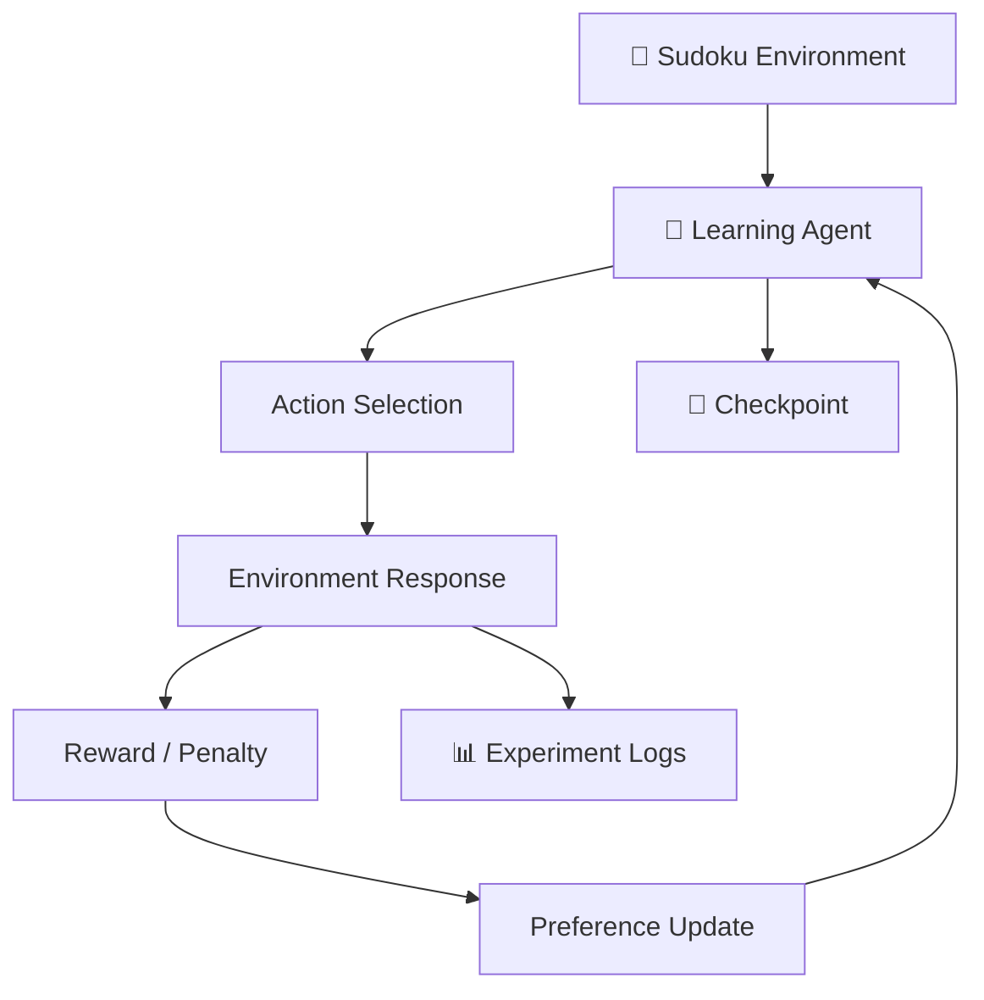

# 🪰 FlySudoku

### An experimental journey into learning through trial and error.

<p align="center">
  <strong>Can a simple learning agent discover how to solve Sudoku without being taught the solution?</strong>
</p>

<p align="center">
  
  
  
  
</p>

---

## 🧠 About

**FlySudoku** is an experimental reinforcement-learning project built to explore how an agent can improve its decisions through interaction, rewards, and mistakes.

Instead of using a pretrained Sudoku solver, the agent begins without a learned strategy. It explores possible actions, receives feedback from the environment, and updates its action preferences.

The goal is not simply to solve Sudoku.

The goal is to experiment with learning itself.

## 🎯 Research Direction

This project is part of a larger exploration into biologically inspired artificial intelligence and neural learning.

The long-term direction is to investigate whether a simulated neural system can gradually develop useful decision-making abilities through experience.

Sudoku is the first experimental environment.

**The broader ambition:**
- 🧩 Experiment with learning through trial and error.
- 🧠 Investigate reward-driven decision-making.
- 🔬 Study how learning behaviour changes with experience.
- ♟️ Eventually explore more complex environments, including chess.

> FlySudoku is an early experimental prototype, not a biologically accurate brain simulation.

## ✨ Features

| Feature | Description |
|---|---|
| 🧩 Mini Sudoku | Interactive 4×4 Sudoku environment |
| 🎲 Puzzle generation | Randomized puzzles with uniqueness validation |
| 🤖 Learning agent | Reward-weighted action preference updates |
| 🔄 Exploration | The agent experiments with possible actions |
| 🏆 Evaluation | Test performance on separate generated puzzles |
| 💾 Checkpoints | Save and load agent state |
| 📊 Experiment logs | Record training and evaluation results |
| 🖥️ Desktop interface | Dark-themed Tkinter GUI |
| 🔌 Offline support | No internet connection or external packages required |

## 🏗️ How It Works



The learning loop:

1. The environment generates a Sudoku puzzle.
2. The agent observes available information.
3. It selects an action using its current preferences and exploration.
4. The environment evaluates the result.
5. Feedback is used to update the agent.
6. The process repeats across training episodes.

The current prototype uses a small linear contextual agent. It is deliberately simple so its behaviour can be inspected and improved.

## 🖥️ Interface

FlySudoku includes a desktop interface for interacting with the environment and observing experiments.

- **Play:** Solve puzzles manually.
- **Train:** Run learning episodes.
- **Evaluate:** Test the agent on generated puzzles.
- **Agent:** Inspect and use the current learned policy.

## ⚙️ Installation

### Requirements

- Windows 10 / 11
- Python 3.11 or newer
- Tkinter
- No additional Python packages required

### Quick Start

1. Download or clone this repository.
2. Extract the project folder if downloaded as a ZIP.
3. Open the folder in Visual Studio Code.
4. Run the launcher:

```powershell
.\START_WINDOWS.bat
```

Alternatively, launch it directly:

```powershell
python -m flysudoku
```

## 🧪 Running Tests

Run the included automated tests:

```powershell
python -m unittest discover -s tests -v
```

The tests cover:
- Puzzle solution validity
- Generated puzzle uniqueness
- Duplicate move rejection
- Agent checkpoint saving and loading

## 📁 Project Structure

```text
FlySudoku/
│
├── flysudoku/
│   ├── __init__.py
│   ├── __main__.py
│   ├── agent.py
│   ├── environment.py
│   ├── experiment.py
│   └── ui.py
│
├── tests/
│   └── test_environment.py
│
├── README.md
└── START_WINDOWS.bat
```

## ⚠️ Current Limitations

FlySudoku v0.1 is a starting point, not a finished intelligent Sudoku solver.

- The learning agent is a lightweight linear model.
- Its learning mechanism updates action preferences rather than neural synapses.
- The current environment filters locally invalid actions before presenting them to the agent.
- The project is not yet connected to the FlyBrain connectome simulation.
- Strong Sudoku-solving performance has not been established.

These limitations are part of the research roadmap.

## 🛣️ Roadmap

- [x] Build a standalone Sudoku environment.
- [x] Implement a basic learning agent.
- [x] Add reward-based preference updates.
- [x] Implement checkpoint persistence.
- [x] Add a desktop interface.
- [x] Add initial automated tests.
- [ ] Improve exploration and learning stability.
- [ ] Introduce experiments where invalid actions receive explicit penalties.
- [ ] Measure performance across larger evaluation sets.
- [ ] Explore integration with FlyBrain neural activity.
- [ ] Investigate more complex environments.
- [ ] Begin chess experimentation.

## 🔬 Philosophy

> Don't teach the agent the answer. Build an environment where it can discover better decisions.

FlySudoku is an experiment in understanding the process behind learning, not just the final result.

Every failure is feedback. Every experiment is data. Every improvement is a step forward.

---

<p align="center">
  <strong>🪰 FlySudoku — Learning begins with the first mistake.</strong>
  <br>
  <sub>Built as an independent learning and research experiment.</sub>
</p>